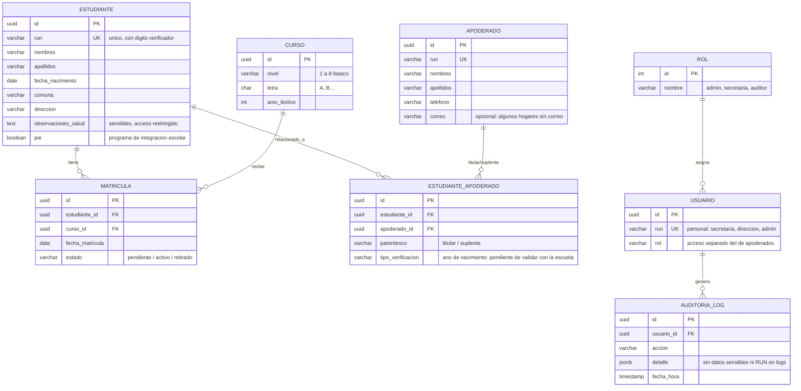

# Diagrama relacional (borrador) — Sistema de Matrícula Escuela Marcela Paz

> **Estado:** borrador previo al acta de constitución (22-10-2026). Alcance de la primera entrega conversado en la [reunión 1](docs/reunion-01-2026-10-21.md): estudiantes ya inscritos por proceso externo y sus apoderados. No representa decisiones aprobadas.

Render: pegar el bloque en [mermaid.live](https://mermaid.live) o abrir con la vista Markdown de GitHub/GitLab.

## Notas del borrador

- **Estudiante–Apoderado es N:M** con tabla intermedia para titular/suplente; es el punto crítico de verificación de identidad pendiente de aprobar (RUT estudiante + RUT apoderado + año de nacimiento no es autenticación suficiente por sí solo).
- **Matrícula** separa estudiante de curso/año lectivo para conservar historial por año.
- **Salud y PIE** quedan como atributos del estudiante en lugar de tabla aparte; si la escuela exige más detalle, conviene tabla propia con permisos específicos.
- Estados (`pendiente / activo / retirado`) tomados del SRS, pendientes de confirmar con la escuela.
