# Documentación técnica — Portal de Matrícula MPAZ 2027

**Escuela Básica Escritora Marcela Paz** · Versión 1.0 · 27-11-2026

Este documento describe la arquitectura del portal con el modelo **4+1**
(escenarios, lógica, procesos, desarrollo y física) y agrega las vistas que el
colegio y la corrección necesitan para operar el sistema: modelo de datos,
estados, seguridad y despliegue.

Todos los diagramas están escritos en **Mermaid**: el bloque se puede leer en el
Markdown o pegar en [mermaid.live](https://mermaid.live). Las versiones
renderizadas están en `diagramas/` (`.svg` para documentos y `.png` para
presentaciones) y las fuentes sueltas en `diagramas/fuentes/*.mmd`.

> **Datos de alumnos:** los ejemplos y diagramas usan datos ficticios. El
> sistema opera con datos reales de menores y queda cubierto por la Ley 19.628
> (y la Ley 21.719 desde el 15-10-2027).

---

## 1. Resumen del sistema

| Dimensión | Valor |
| --- | --- |
| Tipo | Aplicación web MVC renderizada en servidor (ASP.NET Core 10) |
| Usuarios | Funcionarios del colegio con 9 roles; el apoderado no tiene cuenta |
| Módulos | Matrícula, expediente, documentos, salud/PIE, autorizaciones, medicación TENS, certificados, reportes, alertas, funcionarios, configuración |
| Base de datos | PostgreSQL, un esquema `mpaz_matricula` con 27 tablas + tablas de Identity |
| Documentos | PDF generados en el servidor (QuestPDF) con folio y QR |
| Pruebas | 213 pruebas xUnit y un plan manual de 89 casos (75 ejecutados al 27-11-2026) |
| Despliegue | Servicio systemd detrás de Cloudflare Tunnel; alternativa Docker Compose |

Tres decisiones explican casi todo el diseño:

1. **Una sola base con un esquema por módulo.** El dominio y las cuentas de
   Identity viven en `mpaz_matricula`; la cadena `Auth` existe por si algún
   despliegue separa las cuentas.
2. **Los permisos no están en Identity.** Roles y permisos se resuelven desde
   el DDL (`rol`, `funcionario_rol`, `rol_permiso`) y se traducen a políticas
   `Permiso:AREA:ACCION`.
3. **La auditoría es parte del modelo, no un log.** `registros_acceso` e
   `historial_cambios` son tablas solo-inserción: un `DELETE` es rechazado por
   trigger.

---

## 2. Vista de escenarios (el “+1”)

Responde **para qué existe el sistema y quién lo usa**. El apoderado no inicia
sesión: entrega los datos en la escuela y Secretaría los digita.

<!-- diagrama: 01-escenarios -->
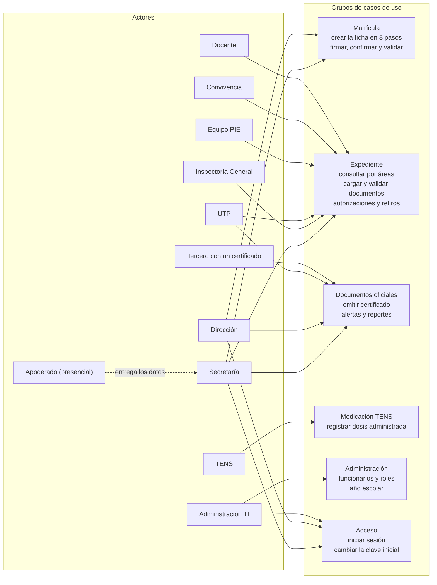

**Lectura del diagrama.** Secretaría concentra el trabajo: crea la ficha, la
formaliza, sube documentos y emite certificados. Dirección valida y firma.
Inspectoría y UTP editan lo suyo (retiros, reportes). PIE, Convivencia y Docente
solo leen. TENS registra dosis. Administración TI no ve alumnos: administra
cuentas y el año escolar.

**Casos de uso y su documento de origen:**

| Caso | Requisito | Dónde se implementa |
| --- | --- | --- |
| Ficha de 8 pasos | MAT-01, MAT-02, MAT-03 | `FichaController`, `RegistroFicha`, `ValidadorFicha` |
| Firma, confirmación y anulación | MAT-04 | `FichaController`, `RegistroFicha`, `AnulacionMatriculaTests` |
| Corrección con versión nueva | MAT-18 | `ficha_version`, `CorreccionesAuditoriaTests` |
| Documentos y validación | MAT-06, MAT-07, MAT-09, MAT-10 | `ExpedienteDocumentos`, `AlumnosController` |
| Autorizaciones y revocación | MAT-12 | `Autorizaciones`, `AutorizacionesTests` |
| Medicación TENS | MAT-05 | `AlumnosController.RegistrarDosis`, triggers `trg_adm_*` |
| Certificados | — | `CertificadosController`, `CertificadoAlumnoRegularPdf` |
| Alertas automáticas | MAT-17 | `AlertasProgramadas`, vista `v_alertas_vencimiento` |
| Reportes y CSV | MAT-16 | `ReportesController` |

---

## 3. Vista lógica

Responde **cómo está organizado el código**. Cuatro proyectos y una regla: la
capa Web no conoce el proveedor de datos.

<!-- diagrama: 02-logica -->
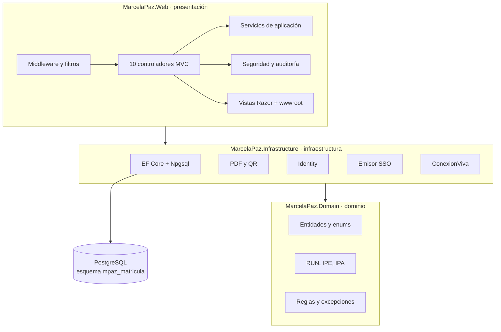

**Responsabilidades por capa:**

| Proyecto | Contiene | No debe contener |
| --- | --- | --- |
| `MarcelaPaz.Web` | Controladores, vistas, servicios de aplicación, seguridad, PDF de presentación | SQL directo ni reglas de persistencia |
| `MarcelaPaz.Domain` | Entidades, enums, identificadores chilenos, validadores puros | Dependencias de EF o ASP.NET |
| `MarcelaPaz.Infrastructure` | DbContext, Identity, OpenIddict, QuestPDF, elección de conexión | Lógica de pantalla |
| `MarcelaPaz.Tests` | 213 pruebas xUnit | Código de producción |

**Controladores y su responsabilidad:**

| Controlador | Rutas principales | Responsabilidad |
| --- | --- | --- |
| `Cuenta` | `/Cuenta/Login`, `/Cuenta/Salida`, `/Cuenta/CambiarContrasena` | Sesión de funcionarios |
| `Home` | `/` | Panel con indicadores del año |
| `Ficha` | `/Ficha/Buscar`, `/Ficha/Paso1..8`, `/Ficha/Comprobante`, `/Ficha/Version` | Asistente, cierre, corrección, PDF |
| `Alumnos` | `/Alumnos`, `/Alumnos/Detalle`, documentos, retiros, dosis | Expediente por pestañas |
| `Certificados` | `/Certificados`, `/Certificados/Emitir`, `/c/{codigo}` | Emisión y validación pública |
| `Reportes` | `/Reportes/Matriculas`, `/Reportes/Faltantes`, `...Csv` | Reportes y exportación |
| `Alertas` | `/Alertas` | Vencimientos por año |
| `FichasMedicas` | `/personal/fichas-medicas` | Salud del funcionario (UTP/Dirección) |
| `Funcionarios` | `/admin/funcionarios` | Cuentas y roles (ADMIN_TI) |
| `Configuracion` | `/Configuracion/AnioEscolar` | Año escolar activo |
| `Autorizacion` | `/connect/authorize` | Emisor SSO (prototipo) |

---

## 4. Vista de procesos

Responde **qué ocurre en tiempo de ejecución**. Cuatro procesos explican el
sistema; el resto son variantes de estos.

### 4.1 Inicio de sesión y autorización por permiso

<!-- diagrama: 03-proceso-login -->
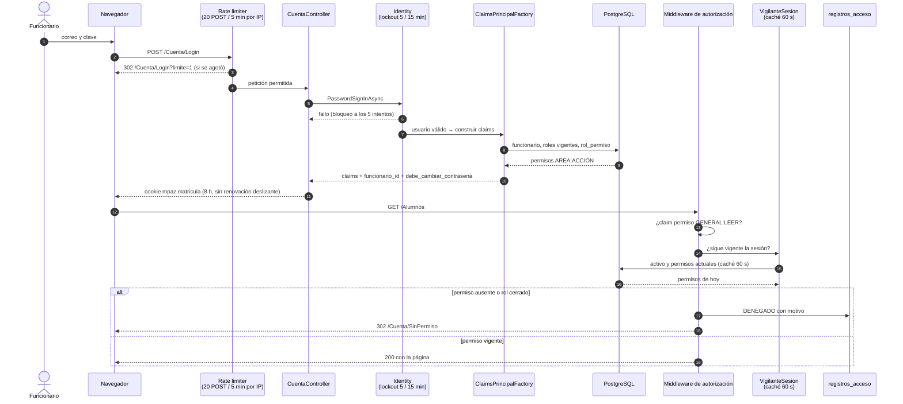

**Puntos finos:**

- El límite por IP frena la prueba masiva de claves; el bloqueo de Identity es
  por cuenta. Una red escolar completa cuenta como un solo origen.
- La cookie dura 8 horas absolutas y **no** se renueva sola: una sesión
  abandonada muere, no se estira.
- `VigilanteSesion` compara los permisos de la cookie con los de la base en cada
  petición autorizada (memorizado 60 s). Quitar un rol invalida la sesión; un
  permiso nuevo no expulsa a nadie, porque tampoco concede nada hasta el
  próximo ingreso.
- Sin sesión no se audita el rechazo: no hay a quién atribuirlo.

### 4.2 Matrícula de punta a punta

<!-- diagrama: 04-proceso-matricula -->
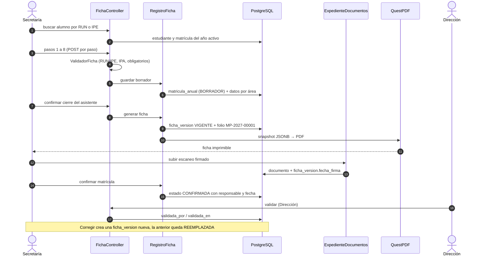

**Estados y reglas:**

- Solo una matrícula no anulada por estudiante y año (índice único parcial).
- `CONFIRMADA` exige responsable y fecha (restricción en la base).
- Anular exige motivo y libera el año; no borra la fila.
- El PDF se genera desde el `datos_snapshot` congelado: la ficha impresa no
  cambia aunque después se edite el expediente.

### 4.3 Certificado de alumno regular

<!-- diagrama: 05-proceso-certificado -->
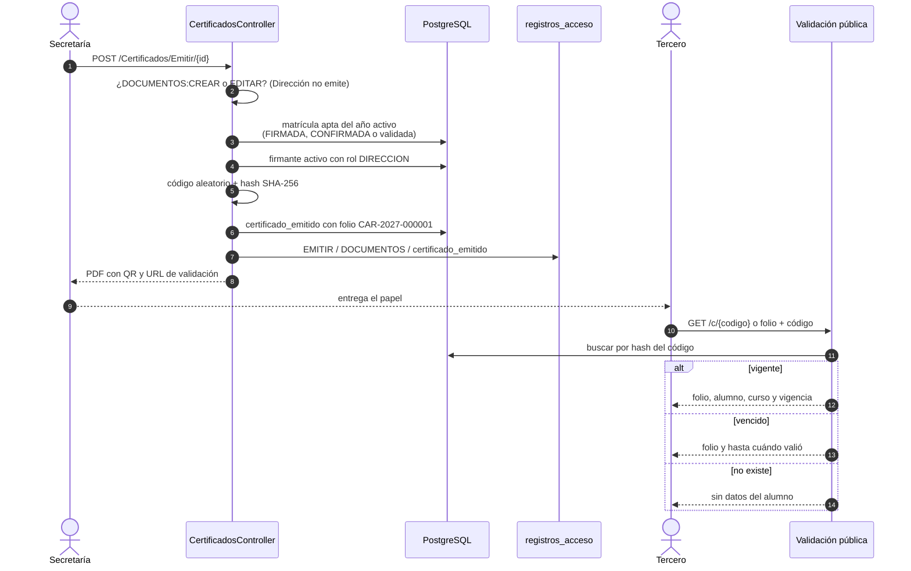

**Reglas:** el código se guarda solo como hash; el folio es correlativo por año;
la vigencia es de 30 días; un certificado anulado responde inválido. La emisión
se audita con la acción `EMITIR`, agregada al `CHECK` de `registros_acceso` en
el paso 28 (antes el `INSERT` fallaba y el rastro se perdía).

### 4.4 Registro de dosis administrada (TENS)

<!-- diagrama: 06-proceso-medicacion -->
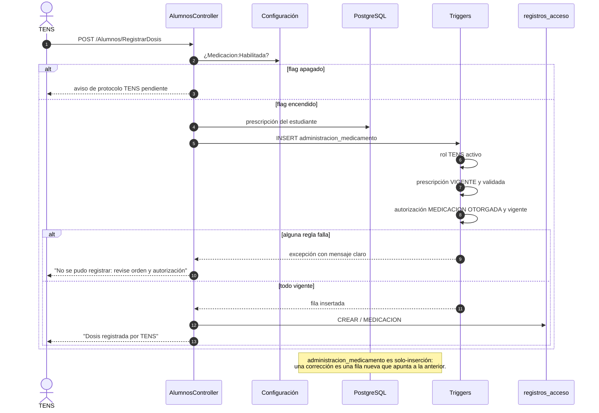

**Límite conocido:** el portal no tiene pantalla para crear ni validar órdenes
médicas; hoy se cargan por SQL. El caso de asma del mock trae una prescripción
vigente para probar el registro.

---

## 5. Vista de desarrollo

Responde **cómo se organiza el trabajo y qué se puede cambiar sin romper**.

<!-- diagrama: 07-desarrollo -->
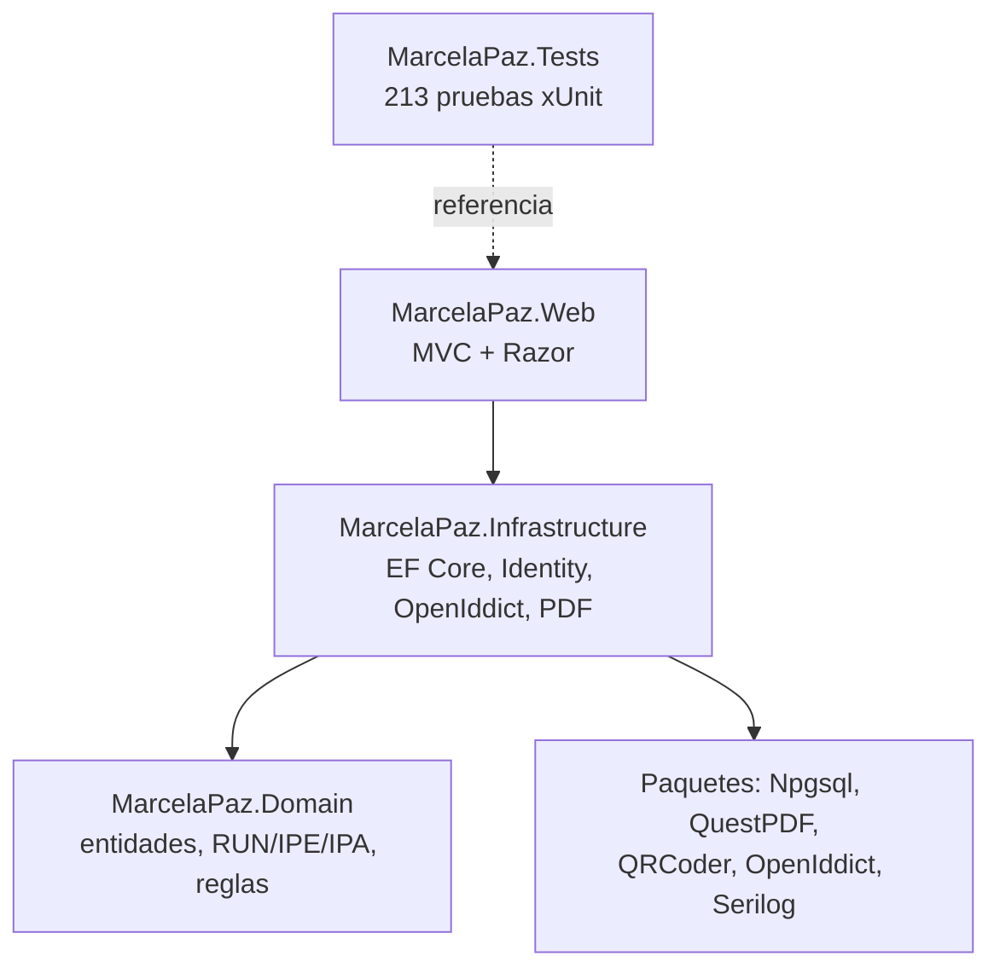

**Dependencias externas (NuGet):**

| Paquete | Versión | Para qué |
| --- | --- | --- |
| `Npgsql.EntityFrameworkCore.PostgreSQL` | 10.0.3 | Acceso a PostgreSQL |
| `Microsoft.EntityFrameworkCore` | 10.0.14 | Modelo y consultas |
| `Microsoft.AspNetCore.Identity.EntityFrameworkCore` | 10.0.14 | Cuentas y hash |
| `OpenIddict.AspNetCore` / `.EntityFrameworkCore` | 7.8.0 | Emisor SSO |
| `QuestPDF` | 2026.9.1 | Fichas y certificados |
| `QRCoder` | 1.8.1 | QR de validación |
| `Serilog.AspNetCore` | 10.0.0 | Registro de la aplicación |
| `xunit` + `Microsoft.NET.Test.Sdk` | 2.9.3 / 17.14.1 | Pruebas |

**Cómo se prueba.** La suite xUnit cubre reglas de negocio, persistencia en
memoria y documentos. El plan manual `docs/plan-pruebas-portal-mpaz.xlsx`
(89 casos) cubre lo que exige navegador, permisos por rol y base real. Los
cambios de esquema se agregan como **paso nuevo** en `database/.../pasos/`, no
editando uno ya aplicado, salvo que el paso sea re-ejecutable y lo declare.

---

## 6. Vista física

Responde **dónde corre cada cosa**.

<!-- diagrama: 08-fisica -->
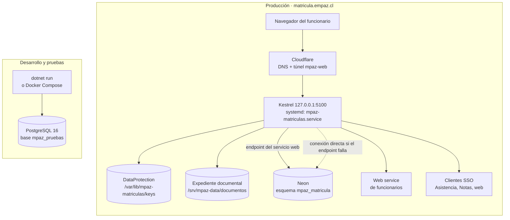

**Configuración que producción exige (el arranque falla si falta):**

| Clave | Motivo |
| --- | --- |
| `ConnectionStrings__Default` | Sin base no hay portal; no se usa una conexión implícita |
| `AllowedHosts` | Debe listar el dominio; `*` se rechaza (S-08) |
| `DataProtection__KeysPath` | Conservar cookies entre reinicios y releases |
| `Seguridad__ExigirInicioSesion=true` | El modo revisión solo existe en Development |
| `Seguridad__ForzarCambioContrasenaInicial=true` | La clave inicial compartida no puede sobrevivir |

Además, el arranque **se detiene** si detecta una contraseña de las que
aparecen en el repositorio o en la documentación.

---

## 7. Modelo de datos

27 tablas en `mpaz_matricula`, agrupadas por área. Se muestran en tres
diagramas —el núcleo de la matrícula, las personas y documentos, y la
seguridad— porque uno solo de 27 tablas deja de leerse. La vista completa está
en `docs/diagrama-relacional.md` (borrador) y en el DDL comentado
(`database/modulos/matricula/pasos/01-ddl-institucional.sql`).

### 7.1 Núcleo: matrícula, ficha, autorizaciones y medicación

<!-- diagrama: 09a-datos-nucleo -->
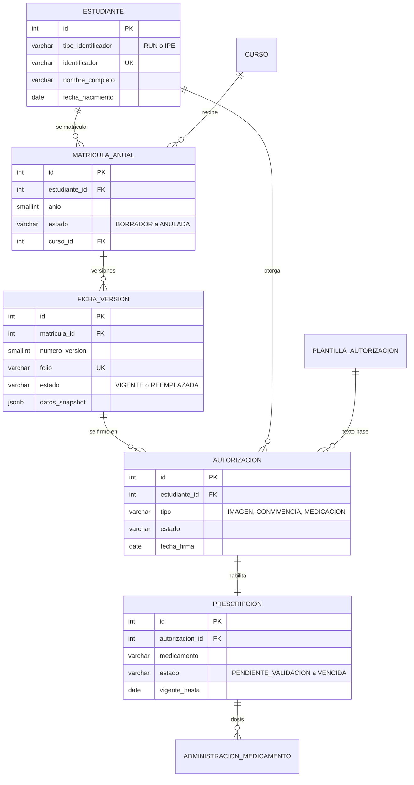

### 7.2 Personas, documentos y datos sensibles

<!-- diagrama: 09b-datos-personas -->
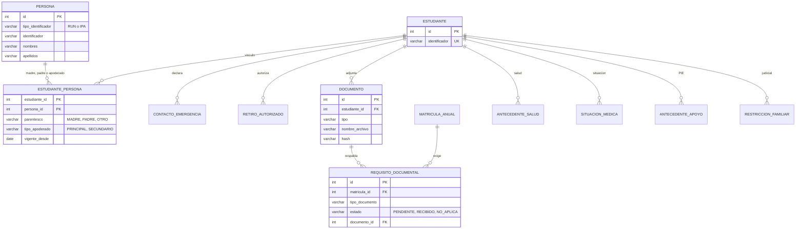

### 7.3 Seguridad y auditoría

<!-- diagrama: 09c-datos-seguridad -->
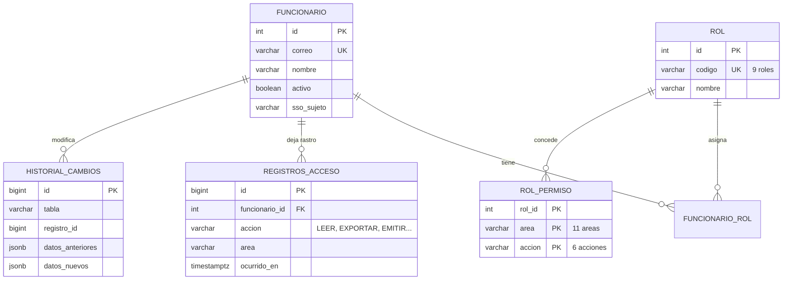

**Reglas estructurales que sostienen la operación:**

- `matricula_anual` tiene un índice único parcial: una sola matrícula no
  anulada por estudiante y año.
- `ficha_version` guarda un `datos_snapshot` JSONB: el PDF impreso no depende de
  tablas que cambian después.
- `autorizacion` exige firmante y fecha para estar `OTORGADA`; `REVOCADA` exige
  fecha de revocación y conserva la firma original.
- `prescripcion` exige `validada_por` y `validada_en` para estar `VIGENTE`.
- `historial_cambios` y `registros_acceso` rechazan `UPDATE` y `DELETE` por
  trigger; solo se poda el resumen técnico de alertas a 24 meses.

---

## 8. Estados

Los cuatro ciclos de vida que el sistema hace cumplir. Los tres primeros están
respaldados por `CHECK` en la base; el cuarto, por triggers.

### 8.1 Matrícula anual

<!-- diagrama: 10-estados-matricula -->
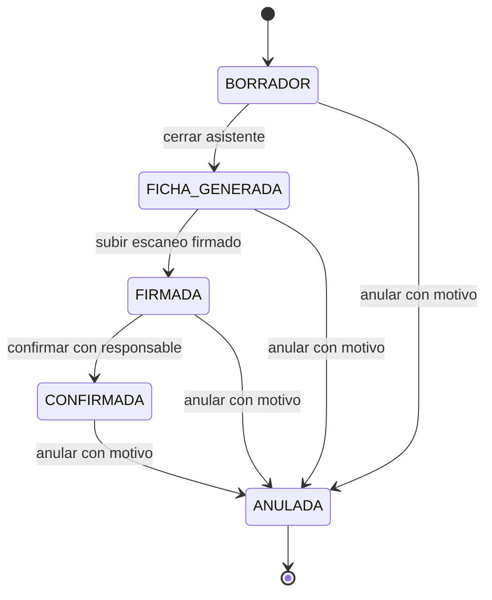

### 8.2 Ficha, autorización y prescripción

<!-- diagrama: 10b-estados-documentos -->
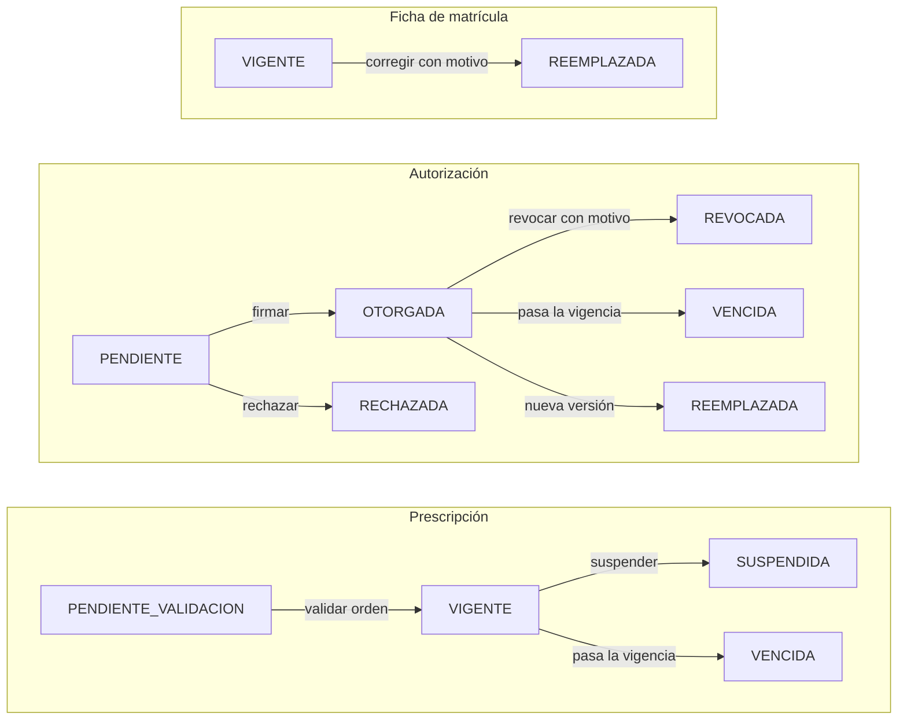

**Lo que no se puede hacer:** confirmar sin ficha vigente, validar sin ser
Dirección, emitir certificado con matrícula en borrador o anulada, registrar
dosis sin orden vigente y autorización otorgada, o borrar una fila de auditoría.

---

## 9. Seguridad

Responde **qué defensas se aplican en cada petición**. La seguridad no está en
una capa: está repartida en el pipeline, en el handler de permisos y en la base.

<!-- diagrama: 11-seguridad -->
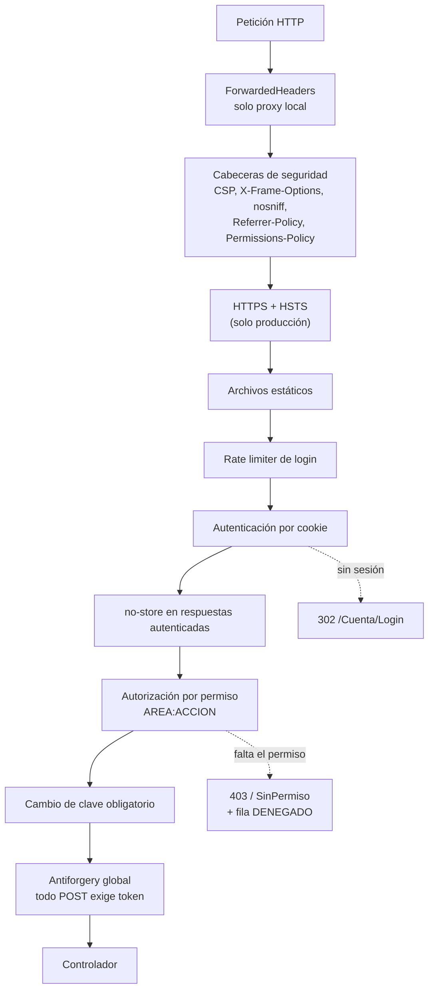

| Defensa | Dónde | Qué evita |
| --- | --- | --- |
| Políticas `Permiso:AREA:ACCION` | `AutorizacionPorPermiso` | Acceso por URL directa a otra área |
| `VigilanteSesion` | Cada petición autorizada (caché 60 s) | Cookie viva de alguien despedido o sin el rol |
| Antiforgery global | `AutoValidateAntiforgeryToken` | POST cruzados desde otro sitio |
| `no-store` | Middleware posterior a la autenticación | Datos de menores en la caché del navegador |
| CSP sin scripts externos | Middleware de cabeceras | Inyección de scripts de terceros |
| Rate limit + lockout | Pipeline + Identity | Fuerza bruta por IP y por cuenta |
| Auditoría de lectura | `registros_acceso` | Falta de trazabilidad de quién vio qué |
| Solo-inserción | Triggers en auditoría | Borrado o alteración del rastro |
| Archivos fuera de `wwwroot` | `ExpedienteDocumentos` | Descarga directa sin permiso |

**Datos personales.** El portal no tiene rutas para apoderados; la única
entrada es el login de funcionarios. Las áreas sensibles (`SALUD`, `PIE`,
`JUDICIAL`, `FAMILIA`) no se consultan si el rol no las tiene: no es que se
oculten en la vista, es que la consulta no se hace.

---

## 10. Protección de datos personales

El portal trata datos de menores —incluidos datos sensibles de salud, PIE y
situación judicial— y datos de salud de funcionarios. Eso lo pone dentro del
ámbito de la **Ley 21.719**, que reemplaza a la Ley 19.628.

### 10.1 Cuándo rige y por qué importa ahora

| Hito | Fecha |
| --- | --- |
| Publicación de la Ley 21.719 | 13-12-2024 |
| Vigencia original (24 meses) | 01-12-2026 |
| **Vigencia actual: 15-10-2027** | Fijada por la **Ley 21.855**, promulgada el 19-11-2026 y publicada el 23-11-2026 |
| Hasta esa fecha | Rige la Ley 19.628 |

La Ley 21.855 cambió la fecha, no las obligaciones: los derechos del titular,
las bases de licitud, los deberes del responsable y el régimen de multas de la
Ley 21.719 quedan igual. Por eso la entrega de este año se documenta ya contra
la ley que va a regir el próximo, y no sólo contra la 19.628.

### 10.2 Qué ya cumple el portal

| Exigencia | Cómo se cumple |
| --- | --- |
| Acceso sólo con cuenta de funcionario | `Seguridad:ExigirInicioSesion=true`; no hay registro público |
| Mínimo necesario por rol y área | Matriz `rol_permiso` (11 áreas × 6 acciones); sin permiso el bloque ni se consulta |
| Trazabilidad de lecturas y cambios | `registros_acceso` e `historial_cambios`, ambos sólo-inserción |
| Datos sensibles separados | Salud, PIE, judicial y medicación son áreas propias; los archivos viven fuera de `wwwroot` |
| Sin cesión a terceros | No hay correo ni analítica de terceros; el único canal externo es el web service con token |
| Conservación sin borrado | Expediente y auditoría no se eliminan; sólo se poda el resumen técnico de alertas |
| Documentos reemplazados | Quedan inactivos, no se borran |

### 10.3 Brechas para el 15-10-2027

| # | Qué falta | Quién lo resuelve |
| --- | --- | --- |
| 1 | **Aviso de privacidad** visible: qué datos, para qué, por cuánto tiempo y cómo ejercer los derechos | Sostenedor aprueba; el portal lo publica |
| 2 | **Procedimiento ARSOP** (acceso, rectificación, supresión, oposición, portabilidad) con plazos y canal | Sostenedor define; Secretaría ejecuta |
| 3 | **Tabla de retención por tipo de dato** (fichas de egresados, licencias del personal) | Sostenedor aprueba |
| 4 | **Responsable de datos** designado y con canal de contacto | Sostenedor nombra |
| 5 | **Evaluación de impacto** para salud, PIE y judicial | Responsable de datos |
| 6 | **Encargados de tratamiento**: contrato o acuerdo de tratamiento con Neon y Cloudflare, y registro de actividades | Coordinación + sostenedor |
| 7 | **Notificación de brechas** a la Agencia y a los afectados | Responsable de datos |
| 8 | **Datos de menores**: constancia de la autorización del apoderado en la ficha | Ya existe la firma; falta el texto legal aprobado |

Las siete primeras no son trabajo de código: son decisiones y documentos del
colegio. La octava depende del texto legal de las autorizaciones, que hoy se
guarda como «Pendiente de aprobación (Dirección)» con el nombre de quien
aprueba.

### 10.4 Qué se implementaría en el portal

Cuando el colegio apruebe los puntos 1 a 4, en el portal quedaría:

1. Una página pública de aviso de privacidad (accesible sin sesión), enlazada
   desde el login y desde el pie de las fichas.
2. Un formulario de solicitud ARSOP que registre la petición, el plazo y la
   respuesta, con su fila en `registros_acceso`.
3. La tabla de retención como parámetro de configuración, no como código.
4. El registro de actividades de tratamiento como documento derivado de esta
   misma arquitectura: áreas, finalidades, plazos y encargados.

> Este apartado orienta el diseño; no es asesoría legal. La calificación de
> cada tratamiento la hace el sostenedor con su abogado.

---

## 11. Operación

### 11.1 Camino de un cambio hasta producción

<!-- diagrama: 12-operacion -->
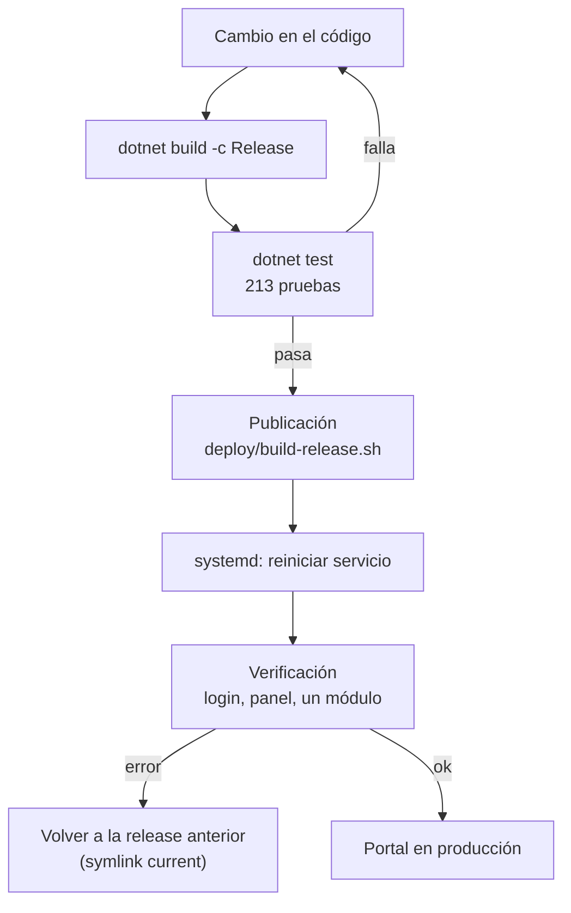

### 11.2 Esquema de la base

`aplicar.sh` recorre `database/.../pasos/` en orden numérico y aplica lo que
falta; `--neon` omite los pasos que crean roles. Las instalaciones nuevas usan
los tres archivos de `instalacion/`, que ya incluyen el esquema completo.

| Necesidad | Paso |
| --- | --- |
| Esquema completo en base nueva | `instalacion/01`, `02`, `03` |
| Base existente sin `EMITIR` en auditoría | `28-accion-emitir-en-registros-acceso.sql` |
| Alertas de vencimiento | `12`, `13` |
| Ficha de salud del personal | `25`, `26` |

### 11.3 Respaldo y restauración

`pg_dump` de la base y `pg_restore` en una base nueva. Se probó en la corrida
del 26-11-2026: 211 KB, restauración sin errores y conteos idénticos en cinco
tablas. El expediente documental vive fuera de la base (`Documentos__RutaBase`)
y se respalda por separado: un respaldo de la base sin esos archivos deja
requisitos apuntando a documentos inexistentes.

---

## 12. Límites conocidos

| Límite | Consecuencia | Estado |
| --- | --- | --- |
| Sin pantalla para órdenes médicas | Una receta nueva exige acceso a la base | Abierto |
| Historial de certificados sin reimprimir ni anular | Si se pierde el PDF hay que emitir otro | Abierto |
| Protocolo TENS sin aprobar | La medicación no debería habilitarse en producción | Abierto |
| Matriz de permisos sin cargar en la base del colegio | Tras el login, las pantallas responden 403 | Abierto |
| SSO en prototipo | `/connect/authorize` no está probado con clientes reales | Fuera de alcance de esta etapa |
| Ley 21.719 | Falta aviso de privacidad y procedimiento ARSOP; detalle en la sección 10 | Rige el 15-10-2027 |

---

## 13. Diagramas y cómo regenerarlos

| Archivo | Qué muestra |
| --- | --- |
| `01-escenarios` | Actores y grupos de casos de uso |
| `02-logica` | Capas, proyectos y componentes |
| `03-proceso-login` | Login, cookie, permiso y sesión revocada |
| `04-proceso-matricula` | Ficha, folio, firma, confirmación y validación |
| `05-proceso-certificado` | Emisión, folio y validación pública |
| `06-proceso-medicacion` | Registro de dosis y triggers |
| `07-desarrollo` | Proyectos, dependencias y esquema |
| `08-fisica` | Producción y ambiente local |
| `09a-datos-nucleo` | Matrícula, ficha, autorización y prescripción |
| `09b-datos-personas` | Personas, documentos y datos sensibles |
| `09c-datos-seguridad` | Roles, permisos y auditoría |
| `10-estados-matricula` | Ciclo de la matrícula anual |
| `10b-estados-documentos` | Ficha, autorización y prescripción |
| `11-seguridad` | Pipeline de defensas |
| `12-operacion` | De un cambio a producción |

Cada uno existe en `diagramas/` como `.svg` (para PDF) y `.png` (para
presentaciones). Los bloques de este documento son la fuente. Para volver a
renderizarlos:

```bash
cd documentacion/modulo-matricula
python extraer_diagramas.py          # escribe diagramas/fuentes/*.mmd

HERR=_herramientas
for f in diagramas/fuentes/*.mmd; do
  n=$(basename "$f" .mmd)
  "$HERR/node_modules/.bin/mmdc" -i "$f" -o "diagramas/$n.svg" \
      -c "$HERR/mermaid-config.json" -b white
  "$HERR/node_modules/.bin/mmdc" -i "$f" -o "diagramas/$n.png" \
      -c "$HERR/mermaid-config.json" -b white --size 1800 -s 2
done
```

`_herramientas/` contiene `mermaid-cli` instalado solo para esta carpeta y no se
versiona. Si no está, se puede instalar de nuevo con
`npm install @mermaid-js/mermaid-cli` dentro de esa carpeta, o pegar cada bloque
en [mermaid.live](https://mermaid.live).
